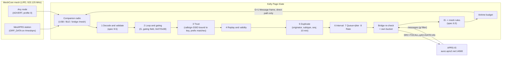

# MeshPRS iGate design: Kelly Page as host

**Status:** design proposal for review. Informative, not normative: the spec (`spec/MeshPRS-Spec.md`) owns every MUST, the subtype table (decision 0002), every byte layout and every drop-reason name. This document applies the spec to Kelly Page and cites spec sections; where it differs from the spec, the spec wins.

**Ground truth used:** `research/00-findings.md` (cited as "findings §n"), decisions 0001 and 0002, the spec, and the Kelly Page iGate code as read on 2026-10-29 (cited as `file:line`). Anything about Kelly that the code doesn't settle is a question for Alec in §12, not an assumption.

---

## 1. Starting point: what Kelly's iGate does today

Kelly's receive-only APRS iGate is MeshPRS profile 0, the advert profile (spec §1.3, `research/prior-art.md`). The facts this design builds on:

| Fact | Where |
|---|---|
| The gate decisions run **in the browser page**: `js/igate.js` `Gate` is pure, driven by `js/igateui.js` | `igate.js:140-197`, `igateui.js:118-141` |
| The APRS-IS connection lives **in the Python bridge**, one persistent connection; the bridge re-checks every field and keeps its own token bucket "so a page bug can't flood APRS-IS" | `kelly_igate.py:1-19`, `:325-375` |
| Pipeline: list (default deny) → valid position → duplicate (30 s) → per-station interval (2 min, 30 s floor if moved > 500 m) → bounded queue (20) with 0-8 s random delay → token bucket 1 per 5 s, burst 3; an item waiting > 30 s for a token is dropped as `rate` | `igate.js:11-16`, `:35`, `:150-188` |
| Drop counters today: `notListed`, `rate`, `duplicate`, `invalid`, `unsent` (page); `rate`, `offline`, `invalid` (bridge) | `igate.js:112`, `kelly_igate.py:182` |
| Line format `SRC>APZKPG,qAO,IGATE:!DDMM.mmN/DDDMM.mmE>comment`; comment cleaned to printable ASCII without `|` `~`, 43 chars | `igate.js:69-74`, `kelly_igate.py:99-105` |
| Lat/lon rounding is half-up in both languages, with shared vectors | `kelly_igate.py:78`, `bridge/igate_vectors.json` |
| Telemetry T# sequence comes from the clock minute | `igate.js:251` |
| Login `user CALL-SSID pass N vers KellyPage x.y [filter F]`; nothing sent until `# logresp ... verified`; `#keepalive` every 2 min; 5 min silence = reconnect; backoff 30 s → 10 min with jitter | `kelly_igate.py:13-17`, `:266-317`, `:153-168` |
| Lines received from APRS-IS are read and discarded | `kelly_igate.py:299-306` |
| Default server `rotate.aprs2.net:14580`, empty filter | `kelly_igate.py:32`, `app.js:76` |
| The passcode is kept in page settings (`settings.igate.pass`, `localStorage` key `kelly.settings`) and synced between a member's Kellys by statesync | `app.js:16-19`, `:76`; `igateui.js:587-588`; `NOTES.md` "APRS iGate" (Sync) |
| Trust: the owner's list (`igateList`) from own adds, node-name offers (`callFromName`) and the signed club list (`igate-wl.js`, Ed25519, `ADMIN_KEYS` pinned) | `igateui.js:1-10`, `igate.js:201-208`, `igate-wl.js:1-30` |
| Raw adverts are signature-checked in the page before they count | `igateui.js:100-110` |
| The companion attaches by Web Serial, Web Bluetooth, or the bridge's `/mesh` WebSocket (`--mesh-serial`, `--mesh-tcp`, `--mesh-ble`) | `mesh.js:10-14`, `kelly_bridge.py:12-13` |
| Received channel data (companion `RESP 27`, `CHANNEL_DATA_RECV`) is logged and dropped, "not shown" | `meshcore.js:71`, `:376` |
| The packet decoder can already decrypt GRP_DATA from a raw log with a channel secret and expose `dataType` + blob | `mcdecode.js:245-275` |
| `CMD_SEND_CHANNEL_DATA` (62) is **not** in Kelly's command table | `meshcore.js:62-68` |
| A headless "keeper" can run Kelly on the Pi with every PC off | `kelly-page/CLAUDE.md` (`bridge/kelly_keeper.py`) |

Two consequences:
- **Kelly gates only while a Kelly page is running** (a browser tab or the keeper). Whether a MeshPRS iGate must run 24/7 is Q-A1.
- **Today's output depends on the iGate owner's settings**: symbol and comment come from the owner's list entry (`igateui.js:135`), and the SSID is whatever the owner typed for that key. The spec forbids that for frames: local lists decide *whether* to gate, never *what* is emitted (spec §10.3).

---

## 2. Architecture and data flow

The RF→IS half is today's `Gate` generalised from "position" to "MeshPRS frame", in the spec §10.1 order. The IS→RF half is the spec's messaging-gateway role (spec §3.2, §6.5), off by default in Kelly (Q-A4). Both keep Kelly's split: the page decides, the bridge re-checks and owns the socket (`kelly_igate.py:3-5`). Where the decisions run (page, keeper or bridge) is Q-A1; the design is the same in each case.

### 2.1 Inputs on the mesh side

| Input | How Kelly gets it | Gated to APRS-IS? |
|---|---|---|
| **MeshPRS frame** (GRP_DATA, MeshPRS data type, `#meshprs` channel; decision 0001, spec §12.1) | (a) companion `CHANNEL_DATA_RECV`, if the channel is set on the node (`SET_CHANNEL`, `meshcore.js:510-519`); or (b) the raw RX log decrypted in the page (`mcdecode.js:245-275`). Which one is Q-A2 | Yes, through the §3 pipeline |
| **Advert** with a position (profile 0) | `NEW_ADVERT` push or raw log, signature checked (`igateui.js:100-111`) | Yes, as today. The per-station interval applies across advert and frame from one station, and the frame is preferred (spec §5.4) |
| **GRP_TXT compact text** (spec §9.7) | `CHANNEL_MSG` | **No, never in 1.0.** The sender is self-asserted and GRP_TXT carries no sender key (findings §1.5, §6). Mesh-side use only |
| **Polled telemetry** (encrypted REQ/RESPONSE, the profile 0 iGate) | the page polls a listed node by direct route (`igateui.js` header lines 13-16) | Allowed by decision 0006 (narrow exception): Q-A12 |

When one frame arrives by both (a) and (b), the duplicate step catches it (same originator, subtype and seq).

---

## 3. The RF → IS pipeline

Exactly spec §10.1, with the drop-reason names it defines:

1. **Decode and validate** (spec §9.5): `short frame`, `unknown version`, `bad callsign`, `unknown subtype`, `experimental subtype`, `unknown flag`, `bad text`. Non-ASCII text is dropped, never transliterated (spec §9.6).
2. **Loop and gating** (spec §9.3): G = 1 → `looped`; gating 1 or 3 → `nogate`; gating 2 → `test` unless connected to a test server (§11); subtypes Query (0x07) and Neighbour report (0x08) → `not gated`.
3. **Trust** (spec §4.3): `untrusted`, `no key`, `key mismatch`, and `unknown ack` for an ack that matches no record (spec §6.2).
4. **Replay** (spec §9.3.1): `replayed`. **Validity** for subtypes with a position: `no fix`, `out of range`, `0,0`, `stale` (by receive time, never the frame's TS, spec §5.3), and `replayed (older advert)` for adverts.
5. **Duplicate** (spec §10.2): key (originator, subtype, seq), retry field ignored, window **10 min** → `duplicate`. On the APRS side, a line identical to one sent in the last 30 s is not sent again.
6. **Per-station interval** (Kelly defaults 2 min, 30 s floor when moved > 500 m; messages, acks and emergencies exempt) → `interval`.
7. **Queue and jitter** → `queue full`. Spec §10.1 step 9: random 0-5 s delay (Kelly today 0-8 s, `igate.js:35`), and a frame not sent within 15 s of receipt is dropped as `expired`; see §7.2 for why the hold must stay short.
8. **Global rate limit** (Kelly: 1 per 5 s, burst 3) → `rate`. Kelly proposal: an item that waits more than **10 s** past its due time is dropped as `rate` (today 30 s, `igate.js:35`, `:184`), because a late copy falls outside the APRS-IS 30 s window (§7.2).

After step 8 the line goes to the bridge, which re-validates its shape and applies its own bucket (`kelly_igate.py:336-375`). The bridge needs a validator for each new shape (message, ack, object, weather, status, bulletin), as `telemetry_ok` is for telemetry (`kelly_igate.py:116-122`). Its refusals and "APRS-IS not up" are Kelly-local counters (§10), not spec reasons.

---

## 4. RF → IS: what each subtype becomes

Common to every line (spec §10.3, §11):
- **Source** = the frame's callsign-SSID claim, gated only if bound to the frame's key prefix (spec §4.3). Never the iGate's call.
- **Tocall** = `APZKPG` (provisional), the same for every MeshPRS gateway (spec §11).
- **Path** = `qAO,IGATECALL` and nothing else (findings §4.2; spec §11).
- **Info** = rendered from the frame alone by the spec §10.3 rules: always uncompressed position, integer half-up rounding, fixed field order, text trimmed and truncated as specified. No iGate-local setting, comment or time, except where the spec itself uses receive time (positionless weather; objects without a plausible TS).

Illustrative lines (values from the spec's own examples where it has them):

| Subtype | APRS-IS line | Notes |
|---|---|---|
| **0x00 Position** | `VK4AZ-9>APZKPG,qAO,VK4AZ-10:!2728.08S/15301.41E>comment` (`=` instead of `!` when the frame's MSG flag is set) | Spec §5.3. CSE extension, then `/A=`, then comment, ≤ 43 chars after the symbol code |
| **0x01 Message** | `VK4ABC>APZKPG,qAO,VK4AZ-10::VK4AZ-9  :See you at the hamfest{7` | ID = msgno in decimal; msgno 0 = no `{ID` (spec §6.5). ≤ 67 chars (spec §6.4); never truncated silently |
| **0x02 Ack** | `VK4AZ-9>APZKPG,qAO,VK4AZ-10::VK4ABC   :ack7` (`rej7` for a rej) | The addressee and original ID come from this gateway's own record of the message; no record → `unknown ack` (spec §6.2) |
| **0x03 Telemetry** | `VK4AZ-9>APZKPG,qAO,VK4AZ-10:T#044,183,097,010,,,00000001` | `T#` = the header seq as 3 decimal digits, 000-255 (spec §7.3). Definitions: §4.1 |
| **0x04 Weather** | `VK4AZ-13>APZKPG,qAO,VK4AZ-10:!2728.08S/15301.41E_090/005g012t072r000p000P000h55b10132` | Units and field order by spec §10.3; positionless weather is timestamped from receive time |
| **0x05 Object / Item** | `VK4AZ-9>APZKPG,qAO,VK4AZ-10:;VK4RBX-M *291030z2728.08S/15301.41Er923.125 MeshCore rpt` (killed: `_` after the name) | Source = the bound owner. `DDHHMMz` from the frame's TS when within ±1 h of receive time, else receive time, truncated to the minute (spec §8.2) |
| **0x06 Bulletin** | `VK4ABC>APZKPG,qAO,VK4AZ-10::BLN1     :Net tonight 1930 on 147.000` | Spec §6.6. Gated once per frame (duplicate step); the iGate does not repeat bulletins itself |
| **0x07 Query** | not gated (`not gated`) | APRS never gates `?` queries to IS (findings §4.2). The iGate MAY answer one addressed to itself on the mesh (spec §6.7) |
| **0x08 Neighbour report** | not gated (`not gated`) | Spec §8.3, §10.1 |
| **0x09 Emergency / Status** | `VK4AZ-9>APZKPG,qAO,VK4AZ-10:>Net control tonight`; with a position: `...:!2728.08S/15301.41E>EMERGENCY Vehicle rollover` | Spec §8.4. Codes 7 and 9 are exempt from the per-station interval, queued ahead of everything else and never dropped for `queue full` while a lower-priority frame is held, but still subject to the global rate limit. Whether APRS software flags a non-Mic-E emergency is UNVERIFIED (spec proposed Q20) |

### 4.1 Telemetry definitions

Definitions are messages from the station to itself, `:VK4AZ-9  :PARM.…` (findings §4.5; spec §7.3).
- **Source of definitions:** for MeshPRS Telemetry frames, the station's own definitions (or profile ID) as received, passed on unchanged; until it has them, the iGate gates values only (spec §7.3). The owner's per-device mapping in Kelly (`igate.js:232-250`, `PRESETS`) is never applied to a frame.
- **Cadence:** the station sends them at start, on change, on query, and at most every 6 h (spec §7.3); the iGate gates each one through the normal pipeline. Kelly's 2-hourly re-send (`igateui.js:28` `TLM_DEFS_MS`) is profile 0 behaviour.

### 4.2 Bulletins and Room Servers

Room-server deliveries are DM-class TXT_MSGs (findings §3.4) and a gateway MUST NOT gate them (spec §6.6, §11). Only the Bulletin frame on the channel (or the APRS-IS original) is gated. A Kelly iGate never logs in to a room to harvest posts.

---

## 5. The APRS-IS session

### 5.1 Login, server, port, filter

- `user <IGATECALL> pass <passcode> vers KellyPage <ver> [filter <F>]` (`kelly_igate.py:275`, spec §11), port 14580. Nothing is sent before `verified` (`kelly_igate.py:290-292`); never `pass -1`, which can't send (findings §4.3).
- Server: `aunz.aprs2.net`, falling back to `rotate.aprs2.net` (spec §11). Kelly's default is `rotate.aprs2.net` today (`kelly_igate.py:32`, `app.js:76`), so the default changes.
- Filter: a receive-only iGate needs none. A messaging gateway uses a `g/` filter with the callsigns heard on the mesh, never a range filter (spec §11). Whether aprsc also routes messages to the client that gated the addressee, and how a filter is updated mid-session, are **to check** on the private aprsc (§11).
- Keepalive, silence timeout and backoff stay as today (§1).
- The iGate's own status line stays `IGATECALL>APZKPG,TCPIP*:>text` (`igate.js:76`; spec §11).

### 5.2 Passcode handling

The passcode comes from a published hash (`igate.js:39-43`, findings §4.3), so it is a weak secret, but APRS-IS etiquette is not to publish it. Today it sits in clear in `localStorage` (`kelly.settings`) and is synced between a member's Kellys; the bridge keeps it in memory and masks it in its log (`kelly_igate.py:279`). Options are Q-A3. Recommendation: the bridge holds it (a bridge-side config file or env var) and the page sends only the call-SSID, because the bridge owns the socket and the page is the part that gets synced and screenshotted.

### 5.3 TOCALL

`APZKPG` (experimental `APZ` range, unallocated, findings §4.4) is the one MeshPRS tocall for all gateways until a registered one is requested from aprs-deviceid before 1.0 (spec §11, Q13). Kelly identifies itself by `vers KellyPage <ver>`, not by the tocall. Kelly already uses `APZKPG` as a constant (`igate.js:33`, `kelly_igate.py:30`), so nothing changes.

---

## 6. IS → mesh (messaging gateway)

### 6.1 What crosses

Only **APRS messages and their acks/rejs addressed to a mesh station** (spec §3.2, §6.5). Never positions, objects, weather, bulletins or telemetry, and not the sender's next position (not in 1.0). Legal under LIPD, subject to R7 (findings §5.5).

A message is injected only if all hold (spec §6.5, findings §4.6):
1. The addressee sent a MeshPRS frame this gateway heard within the last hour.
2. The APRS sender was not heard on the mesh in that hour.
3. The addressee was not heard as a source on APRS-IS in that hour, other than in a MeshPRS-gated line.
4. The path has no `TCPXX`, `NOGATE` or `RFONLY`.
5. The line is not MeshPRS output (MeshPRS tocall with `qAO` in the path): never re-injected (`looped`). The cost: two mesh islands can't message each other through APRS-IS in 1.0 (spec proposed Q30).
6. The text is printable ASCII without `|`, `~` or `{`, at most 67 characters; otherwise refused, never transliterated (`bad text`).
7. No live message to the same addressee holds the same derived ID (`id clash`).
8. The airtime budget (§6.2) has room (Kelly proposal).
9. The gateway has a **direct path** to the addressee (the reversed path of its most recent frame). **Direct only, never flood**; no path = not sent (`no path`). A nearer gateway may have one.

**The frame** is a Message frame with G = 1, seq and msgno derived from SHA-256 of the APRS source and ID (spec §6.5), so it is byte-identical whichever gateway builds it, and repeaters' duplicate table drops a second gateway's copy wherever they meet (findings §1.5, §2.4). It is sent by `CMD_SEND_CHANNEL_DATA` with a real path (findings §2.3), which Kelly lacks today (`meshcore.js:62-68`) and which needs companion firmware ≥ 1.18 (`meshcore.js:71`).

**Retries:** inject the first copy; re-inject at most **2** APRS-side retries of that (source, ID) while no mesh ack has been seen, with the retry field set to 1, then 2; then drop further copies of that ID for 30 min (`duplicate`). Gateways following the same APRS-IS stream reach the same count, so their copies stay identical (spec §6.5). Mesh originators likewise retry at most twice, at 30 s and 60 s (spec §6.3).

**Acks back:** the mesh addressee's Ack frame becomes `:SENDER   :ackID` with the original 1-5 character APRS ID from the gateway's ID record, kept ≥ 30 min (spec §6.5). Whose ack counts is Q14; the spec draft recommends end-to-end.

### 6.2 Airtime budget

LIPD has no duty-cycle limit in 915-928 MHz and MBUG gives no number (findings §5.1, §5.4); the network figure is Q11 / spec proposed Q25. **Kelly proposal (Q-A8, for MBUG):**
- At most **6 s of mesh airtime per 10 min (1 %) per gateway**, counted as packet airtime × (hops + 1).
- At most 1 injected frame per 30 s, and 1 per addressee per 60 s (retries included).
- Over budget: not sent; never queued more than 60 s; never flooded instead.

Airtime at SF8 / 62.5 kHz / CR 4/5 with MeshCore's 32-symbol preamble (findings §1.4, RadioLibWrappers.h:56), by the LoRa time-on-air formula: 21 B ≈ 300 ms, 37 B ≈ 390 ms, 53 B ≈ 470 ms, 69 B ≈ 550 ms. The spec's injected-message example is 53 bytes on air (spec §6.5), so a 3-hop delivery costs 4 × 0.47 ≈ 1.9 s: about 3 messages per 10 min, plenty for APRS messaging and small next to MeshCore's own ~50 % `airtime_factor` ceiling (findings §2.4).

### 6.3 Loops

- **IS → mesh → IS:** injected frames carry G = 1 and every gateway drops G = 1 on the RF→IS side (`looped`, spec §9.3).
- **Mesh → IS → mesh:** a line with the MeshPRS tocall and `qAO` is never injected (rule 5, `looped`), and nor is anything from a sender heard on the mesh (rule 2).
- Mesh-side loops are MeshCore's own loop detect and seen-table (findings §2.2, §2.4).

---

## 7. Several iGates hearing one flood

### 7.1 Identical lines, so APRS-IS merges them

APRS-IS drops a line whose source, destination (without SSID) and info match one in the last 30 s; the path is not hashed (findings §4.6). Spec §10.3 makes every gateway render a frame to the same bytes, so the server keeps the first copy and drops the rest, with no iGate-to-iGate protocol. What that means for Kelly's code:

| Must be identical | Spec rule | Kelly change |
|---|---|---|
| Source | the frame's claim (§4.3) | today from the owner's list entry |
| Tocall | one for all gateways (§11) | none (`APZKPG` already) |
| `!` / `=` | the frame's MSG flag (§5.3) | today always `!` |
| Lat/lon | integer half-up from the raw i24, uncompressed (§10.3) | today float half-up from degrees; add the integer path and vectors |
| Symbol, comment, altitude | from the frame, fixed order and truncation (§10.3) | today from the owner's list entry |
| Message ID, T# seq, bulletin ID | from the frame (§6.5, §7.3, §6.6) | today T# from the clock minute |
| Object time | frame TS within ±1 h, else receive minute (§8.2) | new |
| Nothing else iGate-local | §10.3 | none added today |

The accepted exception: a frame timestamped from receive time (positionless weather, objects without a plausible TS) can render differently either side of a minute boundary (spec §10.3).

### 7.2 Staying inside the 30 s window

Copies must reach APRS-IS within 30 s of each other. A flood relay waits a random `0 … 5 × airtime × 0.5` per hop (findings §2.4): with ~0.4-0.55 s packets that is up to ~1.4 s of delay plus the airtime, roughly 2 s per hop, so ~10 s over 5 hops and ~20 s over 10 (our estimate). Hence the short Kelly holds in §3 (spec §10.1 step 9: jitter 0-5 s, at most 10 s waiting for the rate limit, dropped as `expired` if not sent within 15 s of receipt): worst case about 20 s spread + 15 s hold, which can exceed 30 s on the longest paths. If the field trial (Q12) shows duplicates on aprs.fi, shorten the hold first.

A genuine identical repeat within 30 s is also dropped by APRS-IS (findings §4.6); that is why seq and msgno change per new frame.

### 7.3 Coordination between iGates

Not needed for correctness. An optional saving, not proposed for 1.0: an iGate whose filter includes the station could cancel its pending line on seeing the identical line arrive from APRS-IS during its hold. Kelly's bridge discards what it reads today (`kelly_igate.py:299-306`).

---

## 8. Trust and non-licensed (LIPD) nodes

### 8.1 Rule

Nothing from an unbound key is gated (R1, findings §5.5; spec §4.3 default deny): most MeshCore users in SEQ are LIPD users, not amateurs, and APRS-IS is amateur-only by policy (findings §5.3). Only content the originator put on the MeshPRS channel or in an advert is gated (R3); DMs, private channels, room deliveries and GRP_TXT never are.

### 8.2 The binding (Q6, Q7)

Per spec §4.3, a gateway binds a **callsign-SSID to a full node key**. The frame carries the callsign-SSID claim and (with K) the first 4 bytes of the sender's key; the gateway gates only when the claim is bound and the prefix matches the bound key (`untrusted`, `no key`, `key mismatch`). Without K the frame is mesh-only. The prefix is public, so this catches misconfiguration and casual spoofing, not a determined forger (spec §4.3 item 4; signed frames are spec proposed Q18).

Where Kelly's bindings come from:

| Source | Kelly today | Note for frames |
|---|---|---|
| Owner's own list | `src: 'own'` | Valid; one iGate's view, so another iGate may not gate the same station. That costs coverage, not duplicates, because the line comes from the frame |
| Node-name offer | `callFromName` offers, the owner accepts (`igate.js:201-208`) | A node name is self-asserted; accepting stays a human decision |
| Club signed list | `igate-wl.js`, Ed25519, `ADMIN_KEYS` pinned | The only network-wide binding today, so the one that makes every Kelly iGate agree |

Today an entry binds a key to a callsign and an SSID chosen by the list owner. For frames the entry must bind the **frame's** callsign-SSID; a station using two SSIDs needs two bindings, or a binding rule for "any SSID of this base call" (Q-A7). Spec §4.3 item 5 (require an advert from the bound key in, say, 24 h) is optional; Kelly already sees adverts and could apply it.

---

## 9. Failure behaviour

| Failure | Behaviour |
|---|---|
| APRS-IS down, unverified, or the bridge not answering | Lines are not queued past the §3 hold, because a late position is a duplicate or stale (Kelly-local `unsent` / `offline`). Telemetry definitions wait for the session (today ≤ 10 min, `igateui.js:28`). Mesh originators' own retries cover messages. Backoff as today |
| Companion disconnected | Nothing to gate; IS→mesh treats every addressee as unreachable |
| Wrong clock on the Kelly host | Only the iGate's windows use it (the bridge uses a monotonic clock, `kelly_igate.py:131`). Lines use iGate time only where the spec says receive time (§7.1) |
| Club list fails to verify | Keep the last good copy; drop a kept copy that no longer verifies (`igateui.js:46-47`) |
| Page bug floods the bridge | The bridge's validators and bucket refuse it (`kelly_igate.py:370-373`) |
| Unknown version, subtype or flag | Dropped by spec name (§3 step 1); never a guess |
| Over the IS→mesh budget, or no direct path | Not sent; never flooded |
| Gating = 2 (test) frame on a live server | `test`; only a private server may take it (spec §9.3, §11) |
| Dry run | Logs the exact lines and never connects (today) |

---

## 10. Logging and counters

Every drop is counted under the **spec §10.1 names** (§3 above lists them in order). On the IS→mesh side the spec §6.5 names are `addressee not heard`, `sender on mesh`, `addressee on IS`, `path excluded`, `no path`, `airtime`, `looped`, `bad text`, `id clash` and `duplicate`. Today's Kelly names map onto them (`notListed` → `untrusted`, `invalid` → the specific validity reason, `rate` split into `interval` and `rate`). The last ~30 drops are kept with key prefix and detail, as `Stats` does today (`igate.js:114-136`).

Kelly-local counters, outside the spec's list: the bridge's `offline` and refusals, and `unsent`.

Also kept: heard and gated per subtype, the last line per station (today), IS→mesh airtime used in the current 10 min, and the APRS-IS session state. Lines go to the bridge log with the passcode masked (`kelly_igate.py:279`).

---

## 11. Test hook: a private aprsc

`pass -1` cannot send, and `srvr.aprs-is.net:8080` feeds the live network (findings §4.3), so neither is a test bed.

- Run **aprsc with no uplink** on the bench (the RiverReach Pi or a PC). Kelly already lets server and port be set (`kelly_igate.py:210`, `app.js:76`), so no code change is needed to point at it. Gating = 2 (test) frames may go only there (spec §9.3, §11); Kelly needs a setting that marks the configured server as a test server.
- A **second client** on the same aprsc records what arrives, so a test checks exact lines, server-side dupe drops with two Kelly iGates fed one frame, and the §5.1 to-checks (message routing to the gateway, `g/` filters).
- Mesh side: the in-page MeshCore sim and the bridge's `--mesh-sim` (`mesh.js:220`, `kelly-page/CLAUDE.md`) gain MeshPRS frames, so two simulated iGates can hear one flood with different delays.
- Vectors: the spec's `test-vectors/frames.json` (encode/decode) and `test-vectors/gateway.json` (frame → APRS line, or drop reason by spec name) (spec §15), in the `igate_vectors.json` pattern.
- Dry run stays the first step on real air.

---

## 12. Questions for Alec

- **Q-A1. Where the decisions run, and 24/7.** **→ Decided in 0009** (Pi keeper for the trial). (a) page only, best-effort; (b) the keeper on the Pi; (c) port `Gate` into the bridge. *Recommendation:* (b) for the trial, (c) if MeshPRS iGates are meant to run unattended.
- **Q-A2. How frames reach Kelly.** **→ Decided in 0010.** (a) put `#meshprs` on the companion and read `CHANNEL_DATA_RECV` (fw ≥ 1.18, uses a channel slot); (b) decrypt the raw RX log in the page. *Recommendation:* (a) primary, (b) fallback.
- **Q-A3. Passcode storage.** **→ Decided in 0009** (bridge only). (a) page settings and statesync, as now; (b) bridge-only (config file / env); (c) the bridge computes it from the call. *Recommendation:* (b).
- **Q-A4. IS → mesh in Kelly's first MeshPRS release?** **→ Decided in 0008** (no). (a) none, receive-only; (b) messages only, off by default, as §6. *Recommendation:* (a) for the first field trial, then (b).
- **Q-A5. Default server change** **→ Decided in 0015.** to `aunz.aprs2.net` with `rotate` as fallback, per spec §11. *Recommendation:* yes.
- **Q-A6. Kelly's list entries for frames** **→ Decided in 0019** (bindings from the enabled list entries): rebind existing entries to the frame's callsign-SSID, or keep profile 0 entries (owner-chosen SSID, symbol, comment) for adverts only and add frame bindings separately? *Recommendation:* separate, so profile 0 keeps working unchanged.
- **Q-A7. One binding per SSID, or per base call** **→ Decided in 0015** (per base call, as 0005) ("any SSID of VK4AZ for this key")? *Recommendation:* per base call, since the frame carries the SSID and the spec renders it as sent; ties to Q6/Q7.
- **Q-A8. IS → mesh airtime budget**: 1 % (6 s per 10 min) per gateway, 1 frame per 30 s, 1 per addressee per 60 s, direct only. Take it to MBUG?
- **Q-A9. Hold times** **→ Decided in 0015**: jitter 0-5 s and drop 10 s after due (§3), shorter than today's 0-8 s and 30 s. *Recommendation:* yes, and tune from the trial.
- **Q-A10. Require a recent advert** **→ Decided in 0015** (24 h) from the bound key (spec §4.3 item 5, e.g. 24 h) before gating its frames? *Recommendation:* yes in Kelly; it already sees adverts.
- **Q-A11. Kelly's own beacon** **→ Decided in 0016** (both): keep it as an advert (`igateui.js:299-315`), or also send a MeshPRS Position frame?
- **Q-A12. Profile 0 polled telemetry.** **→ Decided in 0006** (allowed). The exception: a gateway may gate telemetry it polled itself, over encrypted REQ/RESPONSE, from its owner's own bound nodes. Options: (a) allow, owner-mapped as today; (b) frames only, so polled telemetry stops at 1.0. *Recommendation:* (a), limited to the owner's own nodes, since that is today's released behaviour and the owner is the one consenting.

---

## 13. Spec coverage of the iGate's needs

| iGate need | Spec |
|---|---|
| One tocall for all gateways | §10.3, §11 |
| From-APRS-IS loop marker, byte-identical injected frames | §9.3 (G), §6.5 |
| Originator do-not-gate and test flags | §9.3 (gating) |
| `!` / `=` choice | §5.3 (MSG) |
| Station-supplied telemetry definitions | §7.2-7.3 |
| Object timestamp source | §8.2 |
| Callsign claim, symbol, comment from the frame | §5.1, §10.3 |
| Canonical rendering rules | §10.3 |
| Query and Neighbour report not gated | §10.1 |
| seq as dedupe key, T# sequence and replay check | §9.3, §9.3.1, §10.2 |
| Emergency exempt from the interval, queued first | §8.4, §10.1 |
| IS → mesh direct only, no positions, retry limits | §5.6, §6.5 |

Both spec-side requests from this design (IS→mesh drop names, and a hold-time bound) are now in spec §6.5, §10.1 step 9 and §15.2.
